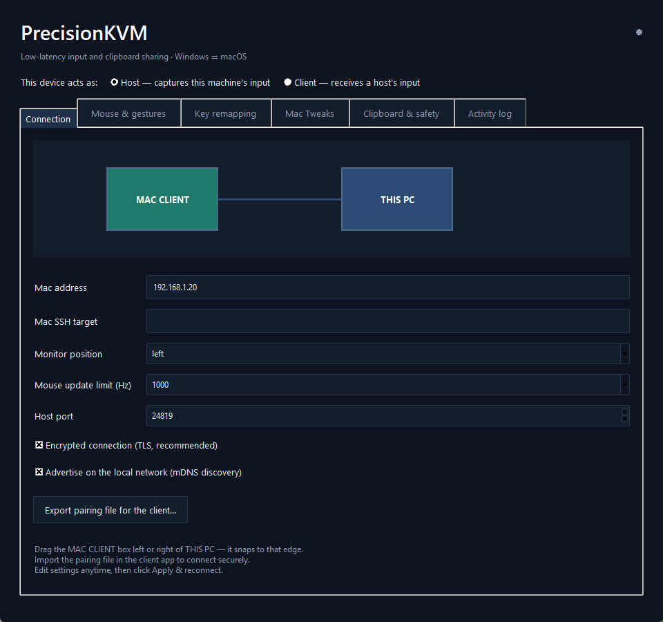

# PrecisionKVM

**A software KVM that feels like a wire.**

[](LICENSE)
[](CHANGELOG.md)

Software KVMs feel laggy because they buffer — events get batched into queues, polled on timers, or relayed through a cloud. PrecisionKVM does none of that. Raw hardware deltas go straight from kernel hooks onto a dedicated LAN socket, the client injects them immediately, and clipboard data rides its own connection so a 30 MB screenshot never delays a keypress.

Median round-trip on gigabit Ethernet: **~0.9 ms at up to 1000 mouse updates per second** — indistinguishable from plugging the mouse in.




## Downloads

Native packages include everything — no Python needed. Each ships a `.sha256` checksum.

| Download | Runs on | Role |
|---|---|---|
| `…-windows-x64.zip` | Windows 10/11 x64 | Host or client |
| `…-windows-arm64.zip` | Windows 11 ARM64 | Host or client |
| `…-macos-arm64.zip` | Apple Silicon | Client or host |
| `…-macos-x64.zip` | Intel Mac | Client or host |

[Get the latest release →](https://github.com/shahriar0247/precision-kvm/releases)

## 60-second setup

1. **PC:** unzip, run `PrecisionKVM.exe`, keep **Host**. Drag the MAC CLIENT box left or right — it snaps to that edge.
2. **PC:** click **Export pairing file**, copy it to the Mac.
3. **Mac:** open `PrecisionKVM.app` (right-click → Open), import the pairing file, grant Accessibility.
4. Press **Start sharing** and slide through the edge.

Either machine can host or client — flip the role picker at the top of the panel.

## Built for deep work

- **Clipboard follows the cursor** — text and PNG images sync both ways; copy on the PC, paste on the Mac.
- **Lock sync** — lock Windows and the Mac locks too; input is never shared onto a lock screen.
- **Mac shortcuts on Windows** — one toggle and Alt behaves like Command (Alt+C/V/Space/Q/arrows) while Alt+Tab stays Windows.
- **Any-key remapping** — named keys, scan codes, media keys, per-modifier; a full keymap table.
- **Gestures** — desktop-switch shortcuts bridge to Mission Control; experimental 4-finger swipe recognition.
- **Live latency graph** — the panel shows the actual round-trip time while you share.
- **Predictable layout** — left/right edge drag only; saved positions can't drift or overlap.
- **Real security** — pairing token + pinned certificate over TLS; toggle off only on a trusted wire. mDNS discovery, configurable port.
- **Tray + login startup** — close the window, it keeps sharing.

It does not stream video and doesn't replace a hardware KVM for BIOS or login screens.

## Controls

| Action | Result |
|---|---|
| Cross the configured edge | Control the client |
| Cross back | Return to the host |
| **Ctrl+Alt+F12** | Return locally, host keeps running |
| **Hold Esc 1.5 s** | Emergency stop — disarms until you restart |
| Close window | Hide to tray |

## Build from source

```sh
git clone https://github.com/shahriar0247/precision-kvm.git && cd precision-kvm
python -m pip install -e ".[ui]"   # Windows — add .[mac] on macOS
python -m precision_kvm gui        # client-gui on the Mac
```

Native package (run on the target OS): `python tools/build_release.py` → `artifacts/*.zip` + `.sha256`.
CI builds all four targets on every `v*` tag — see [docs/releases.md](docs/releases.md).

Checks: `pytest -q` · `ruff check precision_kvm tests` · `mypy precision_kvm` · `python -m precision_kvm doctor`

## Honest limits

- One host ↔ one client; each side's displays act as one shared edge.
- Secure desktops, login screens, elevated apps and macOS Secure Input block capture/injection — that's the OS working as intended.
- Rebuilding the Mac app revokes Accessibility — re-toggle it after each update.
- Linux: package installs, but there are no input backends yet.
- ~0.9 ms is transport RTT on a wired gigabit pair — not a jitter-free guarantee; see [measurements](reports/README.md).

[Contributing](CONTRIBUTING.md) · [Security](SECURITY.md) · [Changelog](CHANGELOG.md) · MIT licensed
